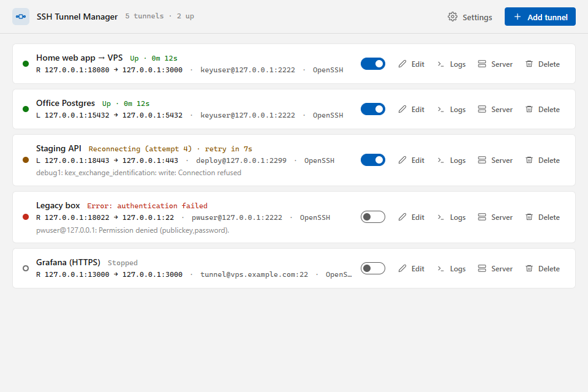
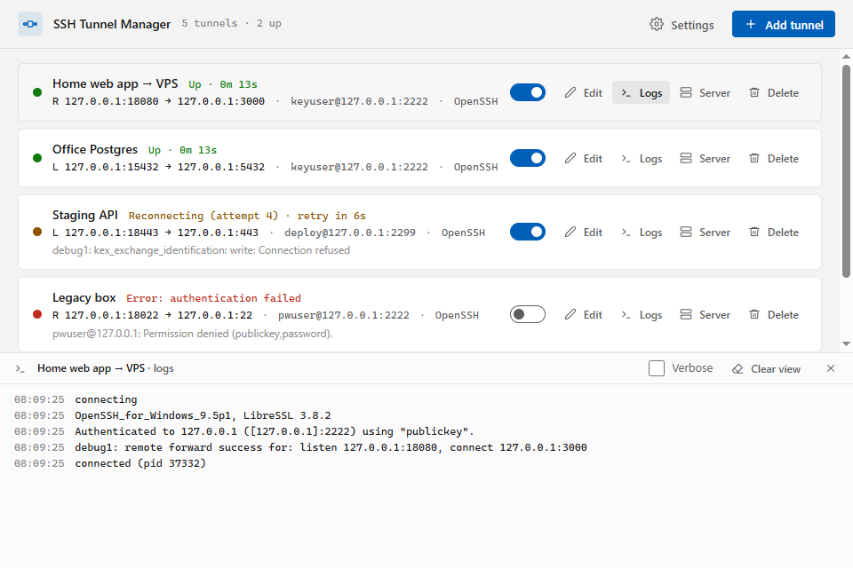
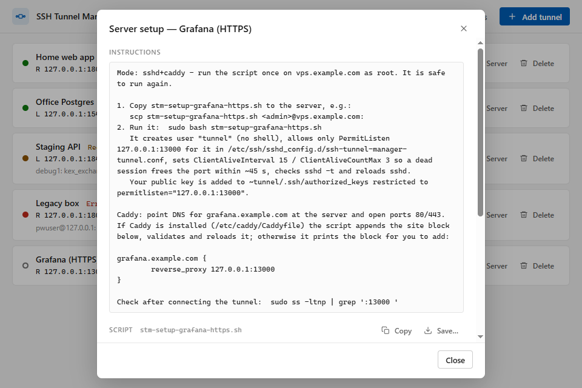

<div align="center">


# SSH Tunnel Manager

**Keep your SSH port forwards up, from the Windows tray.**

[](https://github.com/AdversTM/ssh-tunnel-manager/actions/workflows/ci.yml)
[](https://github.com/AdversTM/ssh-tunnel-manager/releases/latest)
[](LICENSE)


</div>

SSH Tunnel Manager runs your `-R` and `-L` tunnels in the background through `ssh.exe` (Windows OpenSSH) or PuTTY's `plink.exe`. It reconnects them when they drop and lets you switch each tunnel on or off from the tray menu, the way OpenVPN GUI handles VPN profiles.

<p align="center">
  
</p>

<table>
  <tr>
    <td width="50%"></td>
    <td width="50%"></td>
  </tr>
  <tr>
    <td align="center"><sub>Live log for each tunnel</sub></td>
    <td align="center"><sub>Generated server setup</sub></td>
  </tr>
</table>

## Features

- **Two backends per tunnel.** Use OpenSSH (the default) or plink, with your existing keys, Pageant or the Windows ssh-agent.
- **Secrets stay secret.** Passwords and key passphrases live in Windows Credential Manager. They never appear in the config file, the logs or a process command line.
- **Reconnects on its own.**
  - Retries back off exponentially from 1 s to 60 s, with jitter.
  - Keepalives detect dead links.
  - After sleep, resume or a network change, active tunnels restart at once.
  - A wrong password stops the tunnel instead of hammering the server.
- **Host key checks you can trust.**
  - An unknown key asks you to confirm its fingerprint.
  - A changed key blocks the tunnel and shows the old and new fingerprints side by side.
- **Status in the tray.**
  - The icon colour shows overall health: grey idle, green up, yellow reconnecting, red error.
  - Each tunnel gets its own submenu with connect, disconnect and logs.
- **Notifications.** Windows toasts when tunnels drop or recover, grouped into one when several change at once.
- **Starts with Windows**, with optional auto-connect per tunnel.
- **Live logs.** Each tunnel has its own log with a verbose (`debug1`) toggle, and log files rotate on disk.
- **Server setup generator.** For each tunnel it writes a reviewable bash script, an sshd drop-in that limits a dedicated user to that one forward, and a Caddy block for HTTPS. The app never changes your server itself. See [Server setup](docs/server-setup.md).

## Download

Get the latest build from [Releases](https://github.com/AdversTM/ssh-tunnel-manager/releases/latest):

| File | Use it when |
|---|---|
| `ssh-tunnel-manager-<version>-setup.exe` | You want a normal install: per user, no admin rights, a Start menu entry and an uninstaller. |
| `ssh-tunnel-manager-<version>-portable.exe` | You want a single exe that runs from any folder or a USB stick. |
| `SHA256SUMS.txt` | You want to verify a download: `Get-FileHash <file>`. |

The binaries are not code-signed yet, so Windows SmartScreen may ask you to confirm the first start (**More info ▸ Run anyway**).

### Requirements

- Windows 10 or 11, x64, with the WebView2 runtime. Current Windows ships it, and the installer adds it if it is missing.
- The **OpenSSH Client** (Settings ▸ System ▸ Optional features), or PuTTY's `plink.exe` for plink tunnels. You can point to custom paths in Settings.

## Quick start

1. Start the app. It sits in the tray; click the icon to open the window.
2. Click **Add tunnel**, then fill in the server, user and auth method (key file, agent or password).
3. Describe the forward:
   - **`-R` remote:** the server listens on a bind address and port, and forwards to a target this PC can reach.
   - **`-L` local:** this PC listens, and forwards to a target the server can reach.
4. Switch the tunnel on with its **Connect** toggle. On the first connection, compare the host key fingerprint with the server's (`ssh-keygen -lf /etc/ssh/ssh_host_ed25519_key.pub`) and trust it.
5. If the server needs changes, such as a locked-down tunnel user, a public bind or an HTTPS domain, pick a mode under **Server setup** in the tunnel form. Then use the **Server setup** button on the tunnel row to get the script.

## Where things live

| What | Where |
|---|---|
| Config, `known_hosts`, logs, WebView2 cache | `%APPDATA%\SshTunnelManager\` (change it with `-data <dir>`) |
| Passwords and passphrases | Credential Manager, targets `ssh-tunnel-manager:<tunnel id>` |
| Start with Windows | `HKCU\Software\Microsoft\Windows\CurrentVersion\Run`, value `SshTunnelManager` |
| plink keepalive session | `HKCU\Software\SimonTatham\PuTTY\Sessions\ssh-tunnel-manager` |
| Installed app (installer only) | `%LOCALAPPDATA%\Programs\SSH Tunnel Manager\` |

**Command-line flags:** `-data <dir>` sets the data directory, and `-show` opens the window on start. Starting the app a second time brings the running instance to the front.

**Uninstalling:** the uninstaller removes the app and its autostart entry and keeps your data. To remove everything, first delete your tunnels in the window (this also deletes their secrets), then delete `%APPDATA%\SshTunnelManager\`. For the portable build, turn off **Start with Windows** before you delete the exe.

## Documentation

- [Server setup](docs/server-setup.md): the generated script, sshd drop-in and Caddy block, explained.
- [Testing](docs/testing.md): test layers, the Docker test server and acceptance criteria.
- [Manual QA](docs/qa-tray.md): checklist for the tray and system integration.

## Development

The stack is Go with [Wails v3](https://v3.wails.io/) for the shell, and Svelte 5 with TypeScript for the UI.

**Prerequisites:**
- Go 1.26 (`GOTOOLCHAIN=auto` fetches it for you).
- [Bun](https://bun.sh/) 1.4 or newer.
- The Wails CLI: `go install github.com/wailsapp/wails/v3/cmd/wails3@v3.1.0`.

```powershell
wails3 dev                          # run with hot reload
wails3 build                        # release build: bin\ssh-tunnel-manager.exe
wails3 task package VERSION=1.2.3   # NSIS installer: bin\ssh-tunnel-manager-1.2.3-setup.exe (needs makensis)
wails3 build EXTRA_TAGS=qa          # QA build: exposes the WebView2 DevTools port when STM_QA_CDP_PORT is set
go run ./build/genicon              # regenerate build\windows\icon.ico and build\appicon.png
```

### Tests

```powershell
go test ./...                                    # unit tests
cd frontend; bun run check; cd ..                # Svelte and TypeScript checks

docker compose -f test/sshd/compose.yaml up -d   # test sshd on 127.0.0.1:2222
go test -tags integration ./internal/engine      # real ssh.exe and plink against the test server

docker build -t stm-serverkit-test test/serverkit
go test -tags integration ./internal/serverkit   # setup script in a clean Debian, caddy validate

python test/qa_gui.py         # drives the real window over CDP (QA build)
python test/qa_system.py      # autostart and toasts (QA build)
python test/qa_release.py     # release exe with a fresh profile
python test/qa_installer.py   # silent install, upgrade, uninstall
```

[docs/testing.md](docs/testing.md) covers the test keys, `test/sshd/sim.ps1` (simulates a killed session, network loss, a busy port or a rotated host key) and which test covers which acceptance criterion.

### Project layout

```
main.go, service.go, tray.go   Wails app: startup, window service, tray menu
internal/engine                per-tunnel command, askpass, agents, host keys
internal/supervisor            process state machine with backoff
internal/manager               config, state, logs, toasts, host-key prompts
internal/backend               ssh.exe / plink arguments and output classification
internal/serverkit             server setup generator
internal/winsys                autostart, resume and network watchers
internal/{secrets,askpass,…}   Credential Manager, askpass pipe, small helpers
frontend/                      Svelte 5 + TypeScript UI
build/                         icons, manifest, NSIS installer, Taskfiles
test/                          Docker test server and end-to-end QA scripts
```

## Contributing

Issues and pull requests are welcome. Before opening a PR, run `go vet ./...`, `go test ./...` and `bun run check`. If your change touches tunnel behaviour, please also run the integration tests against the Docker test server.

## License

[MIT](LICENSE) © 2026 Damian Szuster
